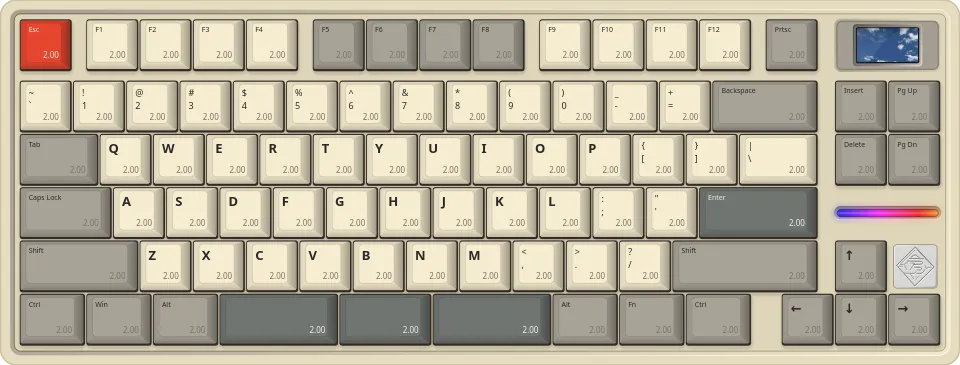

# HM80 Driver


               <p align="center">
  <b>Actuation</b> · <b>Key Modes</b> · <b>Key Functions</b> · <b>Lighting</b> · <b>Layers</b> · <b>Screen</b> · <b>Key Calibration</b>  
</p>
<br>

<p align="center">

  

</p>

   

## Firmware versions

The keyboard compares the firmware version the driver reports with its own. If they differ, it demands a firmware update, stops working and waits for one. So the driver reports back the version the keyboard announces, and never sends a mismatch unless you ask it to install firmware. Whether a firmware works with the driver depends on what that firmware does, each version below was put on a real HM80 with the official images that ship with hm-mag 2.5.3 to 2.5.9 and tried.


| Firmware                   | Status (Tested only on my own keyboard)                                                                                                                                                    |
| -------------------------- | ------------------------------------------------------------------------------------------------------------------------------------------------------------------------------------------ |
| 2.5.3, 2.5.5, 2.5.7, 2.5.9 | The driver connects with no prompt, the saved settings match the keyboard's, and the keyboard types.                                                                                       |
| 2.5.4, 2.5.6               | Not tested, but their images differ from 2.5.7 and 2.5.9 only in the version number. Expected to work.                                                                                     |
| 2.5.8                      | Does not work. Key presses were not registered and the lighting effects were gone. The vendor does not list this version. If your keyboard has it, use **Install firmware 2.5.9** (below). |
| Anything else              | The driver asks before it carries on, and remembers your answer. Nothing is sent to the keyboard until you agree.                                                                          |


### Installing firmware 2.5.9

The driver can flash firmware 2.5.9 onto the keyboard. It is the one version the driver has been checked against from end
to end. The driver never does this on its own, and always asks first.

- **Where:** the **Install firmware 2.5.9** button on the Profile tab (enabled whenever the keyboard runs another version),
the "Untested firmware" prompt, and the prompt shown when the keyboard is stuck waiting for an image.
- **How:** the driver downloads the 2.5.9 image from the keyboard maker's own server, then answers the keyboard's requests
the way the official driver does. It takes a few seconds. **Do not unplug the keyboard or close the driver until it finishes.**
Nothing from the keyboard maker is stored in this repository or in the AppImage.
- **Tested:** on my own HM80 only. It went from 2.5.7 and 2.5.8 to 2.5.9, and it recovered a keyboard stuck waiting for an image.  
It also moved the keyboard between 2.5.3, 2.5.5, 2.5.7, 2.5.8 and 2.5.9 in both directions. An interrupted flash has not  
been tested.

<br>

## ⚠️ Read this first

- **The driver only flashes firmware when you ask it to.** The keyboard only asks for a firmware image when the version in
the driver differs from its own, the driver reports the keyboard's own version back. If the keyboard asks anyway,
the driver offers to install the lastest firmware. A keyboard that is waiting for a firmware replugs itself every 10
seconds or so and does not type. Unplugging it does not help. Installing the firmware does, with this driver or with the
official driver on native Windows.
- **Never run the official Windows driver inside a virtual machine with USB passthrough.** It can push a firmware
update, and a passthrough hiccup midflash can brick the keyboard. This driver or native Windows recovers it.
- **The driver keeps the master copy of your per-key settings.** The HM80 never reports its per-key settings back
to the computer. Instead, the computer tells the keyboard a checksum of each layer, and the keyboard
downloads any layer that differs. So on first run you choose where that copy comes from:
  - **Import your Windows profile** (`Documents\config.m14.hmc`) if you used the official driver. This keeps
  your settings.
  - **Factory defaults** otherwise. They match a keyboard that was never customized, so nothing changes.

  If you start from factory defaults on a keyboard you had customized on Windows, its per-key settings (actuation,
  key mapping) are replaced by the defaults when it connects. Lighting and global settings always come from the
  keyboard itself.
- If you also use the Windows driver, export/import the profile when switching, so both sides have the same copy.

<br>

## Install

### AppImage 

Download `HM80_Configurator-x86_64.AppImage` from the [Releases](https://github.com/bvlthvzvr/HM80Driver/releases)
page.

1. Make it executable and run it:
   ```sh
     chmod +x HM80_Configurator-x86_64.AppImage
     ./HM80_Configurator-x86_64.AppImage
   ```

     You can also double click it in your file manager. A tool like AppImageLauncher can add it to your app menu.
2. Give your user permission to open the keyboard. This is a one time step, described in
[Permission to open the keyboard](#permission-to-open-the-keyboard). An AppImage cannot do it for you,
because it needs root.

If it does not start, the usual cause is a missing FUSE 2 library, which some newer distributions no longer install.
Run it without FUSE instead:

```sh
./HM80_Configurator-x86_64.AppImage --appimage-extract-and-run
```

or install FUSE 2 from your distribution (`libfuse2` on Debian and Ubuntu, `libfuse2t64` on Ubuntu 24.04, `fuse-libs`
on Fedora, `fuse2` on Arch). The AppImage brings its own copy of `libxcb-cursor`, the one X11 library many systems
lack, so it starts on X11 and on Wayland.

### From source

Needs Python 3.10+ and PySide6.

```sh
git clone https://github.com/bvlthvzvr/HM80Driver
cd HM80Driver
pipx install .
```

Then add it to your app menu so it opens with a click like any other app:

```sh
install -Dm644 data/hm80-linux.desktop ~/.local/share/applications/hm80-linux.desktop
install -Dm644 hm80/icon.svg ~/.local/share/icons/hicolor/scalable/apps/hm80-linux.svg
```

### Permission to open the keyboard

The driver talks to the keyboard through its serial port, `/dev/ttyACM*`. This rule lets whoever is logged in at the
computer open that port, and stops ModemManager from probing it with modem commands. Install it once, whichever way you
run the driver.

```sh
echo 'SUBSYSTEM=="tty", ATTRS{idVendor}=="c019", ATTRS{idProduct}=="1234", TAG+="uaccess", ENV{ID_MM_DEVICE_IGNORE}="1"' | sudo tee /etc/udev/rules.d/70-hm80.rules
sudo udevadm control --reload
```

Then unplug the keyboard and plug it back in. 

## Legal

Not affiliated with or endorsed by SikaKeyb, HEMU or the authors of hm-mag.

MIT licensed. See [LICENSE](LICENSE).
